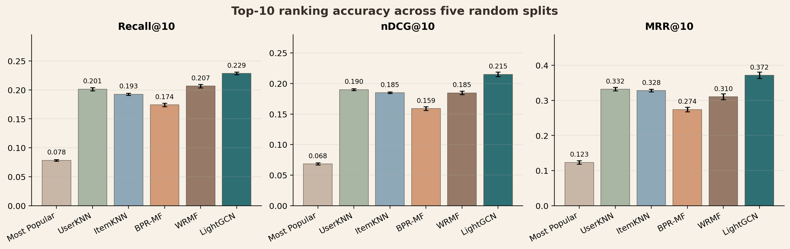
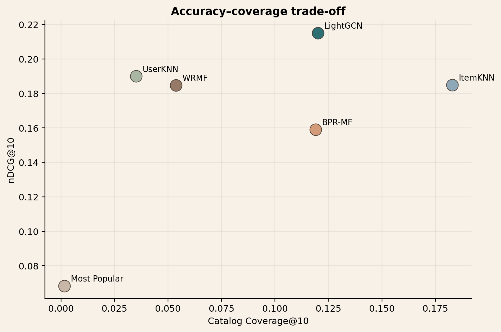

# LightGCN on Last.fm

Artist recommendation with LightGCN and five collaborative filtering baselines on the HetRec 2011 Last.fm 2K dataset: Most Popular, UserKNN, ItemKNN, BPR-MF, and WRMF.

The dataset has 1,892 users, 17,632 artists, and 92,834 observed user-artist pairs. Listening counts are treated as positive implicit feedback; WRMF also uses their magnitudes as confidence weights.

## Run

Python 3.12 is recommended. Install the dependencies, download the data, and run the experiment from the repository root:

```bash
python -m pip install -r requirements.txt
python scripts/download_data.py
python experiment_core.py
```

The default run evaluates all six models on seeds 42-46 and writes metrics and figures under `results/` and `figures/`. To run one split:

```bash
python experiment_core.py --seeds 42
```

PyTorch uses CUDA when available and otherwise runs on CPU. CPU runs take longer. The saved results were obtained with Python 3.12.4 and CUDA; exact values may vary with the environment.

For the self-contained notebook, launch Jupyter from the repository root and open `LastFM_LightGCN_Final_Project.ipynb`:

```bash
jupyter notebook
```

The notebook downloads missing data automatically. Validation search reads the saved search table by default; set `RUN_VALIDATION_SEARCH = True` to run the search defined in the notebook. The saved table also contains additional historical configurations and is not an exact row-for-row output of that search. Running experiments overwrites the corresponding saved result files.

## Evaluation

Each seed uses a shared per-user 80/10/10 train/validation/test split. Held-out interactions are moved into training when needed to ensure every artist occurs in the training catalog. Hyperparameters and early stopping use validation nDCG@10. BPR-MF and LightGCN are then retrained on train plus validation for the selected number of epochs before test evaluation.

Ranking uses the full artist catalog, excluding artists already seen in the fitting data. Metrics are Recall@10, nDCG@10, MRR@10, catalog coverage, and novelty. The reported uncertainty is the sample standard deviation across five shared splits.

## Saved results

| Model | Recall@10 | nDCG@10 | MRR@10 |
| --- | --- | --- | --- |
| Most Popular | 0.0784 ± 0.0014 | 0.0683 ± 0.0018 | 0.1233 ± 0.0050 |
| UserKNN | 0.2014 ± 0.0028 | 0.1900 ± 0.0015 | 0.3321 ± 0.0049 |
| ItemKNN | 0.1925 ± 0.0019 | 0.1850 ± 0.0012 | 0.3281 ± 0.0038 |
| BPR-MF | 0.1741 ± 0.0030 | 0.1591 ± 0.0031 | 0.2741 ± 0.0063 |
| WRMF | 0.2067 ± 0.0029 | 0.1848 ± 0.0027 | 0.3104 ± 0.0086 |
| LightGCN | **0.2286 ± 0.0022** | **0.2151 ± 0.0036** | **0.3717 ± 0.0090** |

LightGCN improves mean nDCG@10 by 13.2% over UserKNN, the strongest baseline on that metric. ItemKNN has higher catalog coverage and novelty. The complete metrics, search records, and run configuration are in `results/`.





## Files

- `experiment_core.py`: data splitting, model implementations, training, evaluation, and plotting.
- `LastFM_LightGCN_Final_Project.ipynb`: self-contained implementation, validation search, experiments, and interpretation.
- `scripts/download_data.py`: downloads and extracts the official dataset.
- `results/`: saved per-seed metrics, summary statistics, validation search, and run metadata.
- `figures/`: saved experiment plots.

## Limitations

The listening records have no listening timestamps, so these are random rather than temporal splits. Catalog repair evaluates warm-start recommendation and does not measure performance on unseen artists. Conclusions apply to this dataset and evaluation protocol; standard deviations describe variation across splits rather than confidence intervals.

## References and data terms

- Xiangnan He et al. (2020). [LightGCN: Simplifying and Powering Graph Convolution Network for Recommendation](https://arxiv.org/abs/2002.02126).
- Steffen Rendle et al. (2009). [BPR: Bayesian Personalized Ranking from Implicit Feedback](https://arxiv.org/abs/1205.2618).
- [HetRec 2011 datasets](https://grouplens.org/datasets/hetrec-2011/), Information Retrieval Group, Universidad Autonoma de Madrid. Last.fm listening data comes from [Last.fm](https://www.last.fm/).

Raw data is downloaded separately. Review the archive's original `readme.txt` before use: the dataset is available for non-commercial use, and commercial use requires contacting Last.fm.
